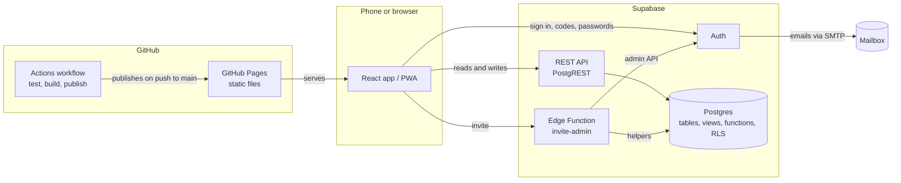

# Architecture

One responsive web app, installable as a PWA, talking straight to a Supabase project. There is no server of our own: the database enforces the rules, and one small Edge Function handles invitations.



## Stack

| Layer | Choice |
| --- | --- |
| UI | React 19, TypeScript, Vite, React Router (basename follows the deploy path) |
| Server state | TanStack Query (cache, refetch after writes) |
| Backend | Supabase: Postgres with row level security, Auth, Edge Functions (Deno) |
| PWA | `vite-plugin-pwa` (auto update, offline read of the last data seen) |
| Look | Black and orange "Locomotiva" theme, Sora font self-hosted, one stylesheet |
| Hosting | GitHub Pages, built and published by GitHub Actions |
| Tests | Vitest, with an in-process Postgres (PGlite) for the database |

## Folder map

```
src/
  main.tsx, App.tsx          entry point and routes
  pages/                     one file per screen
    admin/                   screens only admins can open
  components/                layout, tab bar, lists, icons, shared UI
    Confirm.tsx, Toast.tsx   the app's own confirmation dialog and toasts (never window.confirm)
  lib/
    supabase.ts              the one Supabase client
    api.ts                   every call to the backend (reads, writes, rpc, functions)
    hooks.ts                 TanStack Query hooks over api.ts
    auth.tsx                 session, admin check, sign in / out
    types.ts                 shapes of the data
    outbox.ts, sync.ts       offline: the queue of saved entries and sending them (see offline.md)
    overlay.ts, errors.ts    waiting entries shown in lists; "try later" versus "no"
    groups.ts                grouping rows by day or month for the folded lists (with tests)
    format.ts, season.ts, ... small pure helpers (with tests)
  styles.css                 the whole theme
supabase/
  migrations/                the database, in order
  functions/invite-admin/    the Edge Function
  seed.sql                   demo data (never for a real club)
  cron.sql                   optional daily late-fee job
  tests/                     database tests
scripts/                     fake backend, seed and logo generators
docs/                        this documentation
.github/workflows/deploy.yml build and publish
```

## One layer for the backend

Screens never call Supabase directly. They use hooks in `lib/hooks.ts`, which call functions in `lib/api.ts`. That file is the whole contract with the backend, so a change to a table or function usually touches `api.ts`, `types.ts` and one page. Lists show every row: nothing is cut to "the latest" in the app. (Supabase itself returns at most 1000 rows per request. That is far above a season's payments or fines, but a list that ever reached it would be cut silently.) The everyday money writes in it go through `lib/sync.ts`, which sends them straight away or, offline, saves them for later.

Reads go to the three views (`fine_ledger`, `player_balance`, `club_summary`) and plain tables. Anything involving a rule (settling payments, late fees, closing a season, admin changes) is done **in the database**, never recomputed in the browser.

## Screens and routes

The base path is `/` locally and `/<repo>/` on GitHub Pages.

| Route | Screen | Who |
| --- | --- | --- |
| `/` | Dashboard: the box, how many players are in debt, overdue or up to date, and the biggest debt | everyone |
| `/players`, `/players/:id` | **Plantel**: the roster with search and filters, and one player's debts, credit and history | everyone |
| `/fines` | Fines filtered by date, player, type, status, grouped by day | everyone |
| `/regulamento` | The rules of the fines: one card for every fine being enforced (the active fine types, then the automatic late fee), with its description on the left and its value on the right. The late fee card has a line under it saying that fines not paid by the due day are marked as vencidas and that this fine is then added. `/caixa`, the old address of the box page, redirects here. **For admins the same page also holds the fine types**: the form to add one at the top, and on every type (including inactive ones, so they can be switched back on) its name and value, the **Ativo** box, Guardar and Apagar. `/admin/catalog`, where this used to be, redirects here | everyone; the editing only for admins |
| `/login` | Admin sign-in | everyone |
| `/recover` | First access / forgotten password with an emailed code | everyone |
| `/set-password` | Where the invitation link lands | whoever the link signed in |
| `/admin/fines/new` | Register fines (one or many players) | admins |
| `/admin/payments` | Record payments, and see and delete **every** payment: grouped by month in sections that open and close (closed at first), with a search box (player, note, amount, date or month) and a player filter. Searching or filtering opens the matching months | admins |
| `/admin/money` | Income and expenses | admins |
| `/admin/players` | Roster management | admins |
| `/admin/admins` | Invite, resend, cancel, remove admins | admins |
| `/admin/archive` | Archived seasons | admins |
| `/admin/history` | Every change with who made it, and putting back what was deleted | admins |
| `/admin/settings` | Season, due day, late fee, close season | admins |

`/admin/*` is wrapped by `RequireAdmin`, which sends everyone else to `/login`. That is a convenience: the real protection is row level security, which would refuse the writes anyway.

On phones there is a bottom tab bar (Início, Plantel, a centre button, Multas, Regulamento). The centre button is **Entrar** when nobody is signed in and **Menu** for admins, opening the admin options. On wide screens the same links appear in a sidebar. It is the same code, switched in CSS.

## Long lists are folded

Every long list is split into sections that open and close, and **all start closed**: fines by day (Multas, Histórico), and payments, income, expenses and a player's fines and payments by month. Each header shows the day or month, how many entries it holds and, where money is involved, the total. If there is more than one section, an **Abrir tudo / Recolher tudo** link opens or closes them all.

Searching or filtering opens the sections that match, so nothing is hidden behind a closed header. Clearing the search closes them again. Nothing is cut: a closed section still holds every entry, and every list, total and action works as before.

It is one pair of pieces: `groupRows` in [`lib/groups.ts`](../src/lib/groups.ts) (pure: groups consecutive rows by day or month and adds up their amounts) and the `Folded` component ([`components/Folded.tsx`](../src/components/Folded.tsx)), which takes the rows, how to find a row's date, how to draw one row, whether the list is being filtered, and a `resetKey` that closes the sections again when the filters change. A new long list should use it rather than draw its own sections.

## Layout and scrolling

The page itself never scrolls: `body` is fixed and `#root` is the only scroller, with `overscroll-behavior: none`. This stops Safari dragging the whole page. Header, tab bar and menu are fixed. Pages pin their filters in a `.sticky-box`. Changing page scrolls `#root` back to the top.

## Offline and updates

The service worker caches the app files and keeps the last answers from the REST API (`NetworkFirst`, 5 second timeout, 30 days), so the app opens and shows the last data without a connection. The app asks for data even when offline (`networkMode: 'offlineFirst'`), so those saved answers are used.

Admins can keep working offline: the day-to-day entries (fines, payments, income, expenses, and cancelling or deleting them) are saved on the phone and sent when the connection returns, safely and in order. Everything else, including sign-in, needs a connection. The full picture is in [offline](offline.md).

Updates are automatic. An installed iPhone app picks up a new version after being closed and reopened (twice in practice). The home-screen icon only changes by removing the app and adding it again.

## Build and deploy

On every push to `main`, [`deploy.yml`](../.github/workflows/deploy.yml) runs the tests, builds with `BASE_PATH=/<repo>/`, copies `index.html` to `404.html` (Pages has no single-page fallback, so deep links need it) and publishes. The Supabase URL and the publishable key are written in the workflow: they are public by design.

The published page carries a strict content-security policy (a meta tag added at build time by `vite.config.ts`): it may run only its own scripts and talk only to itself and the Supabase project. See [security](security.md#the-content-security-policy) before adding an outside script, font or API.

Database changes and the Edge Function are **not** deployed by this workflow. See [operations](operations.md).
