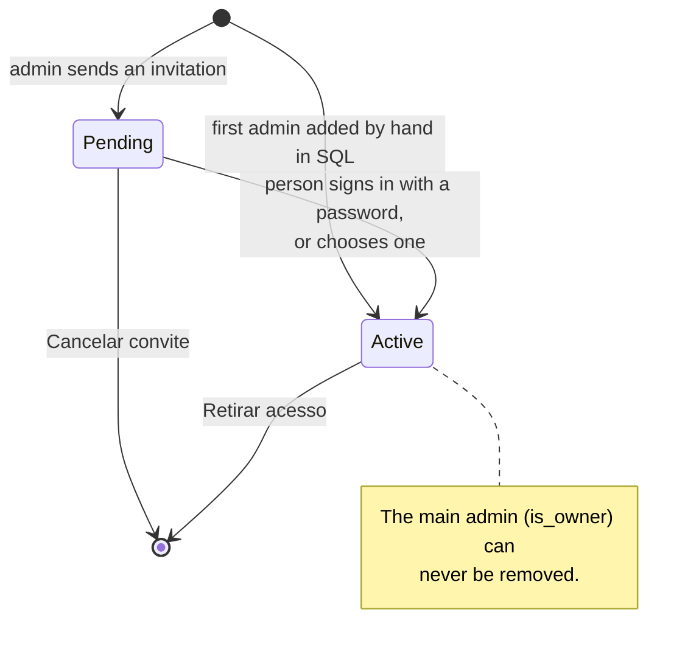
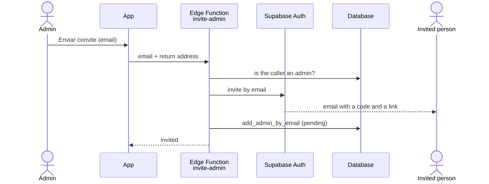
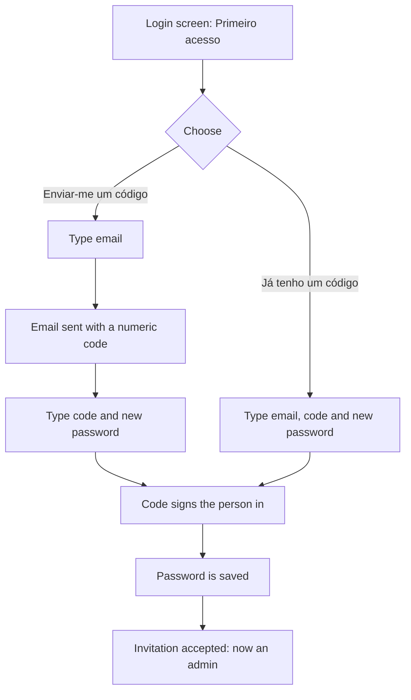

# Sign-in and admins

Two kinds of people use the app:

- **Visitors** need no login. They can read everything.
- **Admins** sign in with email and password and can write. An admin is added by invitation, or by hand for the very first one.

Accounts live in Supabase Auth (`auth.users`). Being an admin is a separate fact, recorded in `public.admins`. Having an account is not enough.

## The states of an admin entry



| State | In the database | Rights | Shown on Administradores as |
| --- | --- | --- | --- |
| Pending | row with `accepted_at` null | none | **Convite pendente**, with Reenviar convite and Cancelar convite |
| Active | row with `accepted_at` set | full | email, with Retirar acesso |
| Main admin | `is_owner = true` | full | **Principal**, no button, listed first |
| None | no row | none | not listed |

Why pending exists: an invitation is not an admin. Until the person has actually signed in or chosen a password, they are not trusted with write access, even though their email has an account and may even hold a session from an invitation link.

Removing someone only deletes the admin row. Their login account stays, so inviting them again later works.

## Inviting someone



The function never trusts the browser: it checks the caller's session and `is_admin()` first, then uses the service role for the privileged steps. It is deployed with `verify_jwt = false` and does that check itself.

### What the function answers

| Status | Meaning | UI message |
| --- | --- | --- |
| `invited` | New account, invitation email sent, pending entry recorded. | Convite enviado |
| `resent` | The email already had an account and its invitation is still pending, so a fresh code was emailed. | Enviámos um novo código |
| `already_admin` | The person is already an accepted admin. Nothing is sent. | já é administrador |

Errors: `400` for a bad email or when Supabase refuses (for example its per-address rate limit, whose message is passed through); `401` no valid session; `403` caller is not an admin; `500` if the database helper fails (the email may already have gone out, and the message says so).

Admin rights are never inserted directly into `admins` by the function. It calls the `add_admin_by_email` helper instead, because the service role has no rights on that table.

## The person's first access

There are two ways in. Both end with a password and an accepted invitation.

**1. The link in the email.** It signs the person in (without a password) and lands on `/set-password`, where they choose one. Links work **once**, and email scanners can use them up, so there is a second way.

**The link and the code in one email are the same one-time key.** Using either spends both: someone who opens the link and then types the code is told the code is invalid or expired. The email says to use only one. If the person is already signed in by the link, they do not need a code at all: the app takes them to choose a password (see below).

**2. Primeiro acesso (`/recover`), with a code.** No link needed:



Details that matter:

- Asking for a code (`requestAccessCode`) never says whether the address was invited: an unknown address gets the same answer as a known one. It never creates an account (`shouldCreateUser: false`). Only rate limits and mail failures are shown as errors.
- Finishing (`finishAccess`) tries the code as `email`, `signup`, `invite` and `recovery`, because which type applies depends on how the account was created. If none works it says the code is invalid or expired.
- The emails must contain the code. That needs the template change described in [operations](operations.md#supabase-dashboard-settings).
- The same page also serves as "forgot password" for any existing account.

## How the app decides someone is an admin

[`lib/auth.tsx`](../src/lib/auth.tsx), whenever the signed-in user changes:

1. Ask the database `is_admin()`.
2. If the answer is no **and** this is right after a password sign-in or right after choosing a password, call `accept_admin_invite()` once, then ask `is_admin()` again.
3. If the person is an admin, run `apply_late_fees_admin()` so overdue fines get their late fee.

Step 2 is the only way a pending invitation becomes active. A plain session (for example from opening the invitation link and doing nothing) never accepts it.

A signed-in person who is not an admin and has a pending invitation sees "O seu convite ainda não foi concluído" on the login page with a link to finish. Anyone else signed in but not an admin just sees that they have no admin rights. The pending check only ever reports on the caller's own invitation.

### Signed in by the link, but no password yet

Opening the link signs the person in, but they are not an admin until they choose a password. The app handles that state on purpose:

- The first time the app opens for them, it takes them straight to **Escolher palavra-passe**. After that they can look around freely.
- If they go to the login page, it says "O seu convite ainda não foi concluído" with a button to **Escolher palavra-passe**. It never signs them out: their session is the proof of their email, and a code that is already spent cannot replace it.
- Choosing a password accepts the invitation, and they are an admin from then on.

## The main admin

The main admin is marked `is_owner`. `remove_admin()` refuses to remove them, whoever asks, and the screen shows no button.

The flag is set in two places, and which one applies depends on when the first admin was added:

- **On an existing database**, migration `20261117000000_main_admin.sql` marks the earliest account that is an accepted admin, so no email address is written in the code.
- **On a new database**, the migrations run before the first admin exists, so the flag has to be set when that admin is added (see below).

To change who the main admin is, update the column by hand in the database.

## Adding the very first admin

Nobody can invite the first admin, so it is added by hand in the SQL Editor after creating the user in Supabase (step 3 of the README):

```sql
insert into admins (user_id, is_owner) select id, true from auth.users where email = 'their@email';
```

A row inserted this way is active immediately (`accepted_at` defaults to now) and, with `is_owner`, protected.
