# Data model

Everything lives in one Postgres database (Supabase), in the `public` schema, plus Supabase's own `auth.users` table for logins. The schema is defined only by the files in [`supabase/migrations/`](../supabase/migrations/); nothing is created by hand.

- [Entity diagram](#entity-diagram)
- [Tables](#tables)
- [Views](#views)
- [Functions](#functions)
- [Who can read and write what](#who-can-read-and-write-what)
- [Business rules](#business-rules)
- [Migration history](#migration-history)

## Entity diagram

```mermaid
erDiagram
    AUTH_USERS ||--o| ADMINS : "may be"
    PLAYERS ||--o{ FINES : "receives"
    PLAYERS ||--o{ PAYMENTS : "makes"
    PLAYERS |o--o{ INCOMES : "optionally gives"
    FINE_TYPES ||--o{ FINES : "classifies"
    PLAYERS ||--o{ LATE_FEE_WAIVERS : "may be waived"
    SEASON_ARCHIVE ||--o{ SEASON_ARCHIVE_PLAYERS : "summarises"
    SEASON_ARCHIVE ||--o{ SEASON_ARCHIVE_TYPES : "summarises"

    AUTH_USERS {
        uuid id PK
        text email
    }
    ADMINS {
        uuid user_id PK "FK auth.users, cascade"
        timestamptz accepted_at "null = invitation pending"
        boolean is_owner "main admin, cannot be removed"
    }
    PLAYERS {
        uuid id PK
        text name UK
        text role "player or staff"
        boolean active
    }
    FINE_TYPES {
        uuid id PK
        text name UK
        numeric default_amount
        boolean active
    }
    SETTINGS {
        boolean singleton PK "always true: one row"
        numeric late_fine_amount
        int due_day "1 to 28"
        text season "2026/27"
    }
    FINES {
        uuid id PK
        bigint seq "tie-break for same-day fines"
        uuid player_id FK
        uuid fine_type_id FK "null for late fees"
        text kind "fine or late_fee"
        numeric amount
        date fined_on
        text description
        date late_for_month "only for late fees"
        boolean cancelled
    }
    PAYMENTS {
        uuid id PK
        uuid player_id FK
        numeric amount "greater than 0"
        date paid_on
        text note
    }
    INCOMES {
        uuid id PK
        uuid player_id FK "nullable"
        numeric amount
        date received_on
        text description
    }
    EXPENSES {
        uuid id PK
        numeric amount
        date spent_on
        text description
    }
    LATE_FEE_WAIVERS {
        uuid player_id PK "FK players"
        date month PK "first day of the month"
        timestamptz waived_at
    }
    CHANGE_LOG {
        bigint id PK
        timestamptz at
        uuid who "null = the system"
        text action "insert, update or delete"
        text table_name
        jsonb old_row
        jsonb new_row
    }
    SEASON_ARCHIVE {
        uuid id PK
        text season
        timestamptz closed_at
        numeric box "and the other season totals"
    }
    SEASON_ARCHIVE_PLAYERS {
        uuid archive_id PK
        text player_name PK
        numeric total_fined "and paid, outstanding, credit"
    }
    SEASON_ARCHIVE_TYPES {
        uuid archive_id PK
        text fine_type PK
        int fines_count
        numeric total_amount
    }
```

`settings` has no relationships: it is a single row of club-wide configuration. `change_log` is not linked to the others on purpose: it must survive them being deleted.

## Tables

### Money in and out

| Table | Purpose | Notes |
| --- | --- | --- |
| `fines` | One row per fine **and** per automatic late fee. | `kind = 'fine'` needs a `fine_type_id`; `kind = 'late_fee'` needs `late_for_month` (a check constraint enforces both). `cancelled` hides a fine without deleting it. |
| `payments` | Money a player has paid. Always positive. | Not tied to a specific fine; see [how payments settle fines](#payments-settle-fines-oldest-first). |
| `incomes` | Money into the box that is **not** a player's debt: prizes, donations. | `player_id` is optional and becomes null if that player is deleted. |
| `expenses` | Money out of the box. | Free-text `description`. |

### People and catalog

| Table | Purpose | Notes |
| --- | --- | --- |
| `players` | The roster: players and technical staff (`role`). | `name` is unique. `active = false` hides someone from the Plantel page for visitors (admins still see them, to switch them back on) without losing history. |
| `fine_types` | The catalog of possible fines with a default amount. | The amount can be edited per fine when it is registered. |

### Configuration

| Table | Purpose | Notes |
| --- | --- | --- |
| `settings` | One row: `late_fine_amount` (default 5), `due_day` (default 7, 1 to 28) and `season` (format `2026/27`). | Admins can update it; nobody can insert or delete rows. |

### Access

| Table | Purpose | Notes |
| --- | --- | --- |
| `admins` | Who may write. A row is an invitation or an admin. | `accepted_at` null means the invitation is **pending** and gives no rights. `is_owner` marks the main admin. Details in [auth and admins](auth-and-admins.md). |

### Safety records

Two tables the app never writes to directly: the database fills them in.

| Table | Purpose | Notes |
| --- | --- | --- |
| `late_fee_waivers` | Remembers a late fee that an admin **deleted**, per player and month, so the automatic rule does not add it again. | Written by a trigger on `fines`. Cleared when a season is closed. Admins can read it. |
| `change_log` | A permanent record of every insert, update and delete on fines, payments, income, expenses, players, fine types and the settings: who, when, and the row before and after. | Written by triggers. **Closed to the app**: nobody, admins included, can read it except through `list_changes()` or change it at all. `who` is null when the system did it (the daily job, the dashboard, a script). |

### Season archive

Written only by `close_season()`. Admins can read and delete rows; nobody else can see them.

| Table | Contents |
| --- | --- |
| `season_archive` | One row per closed season: counts and totals (fined, paid, outstanding, credit, income, expenses, box). |
| `season_archive_players` | Per player in that season: fines count, fined, paid, outstanding, credit. Only players with activity. Stored by **name**, so it survives the player being deleted. |
| `season_archive_types` | Per fine type: how many fines and how much. Late fees appear as "Multa de falta de pagamento". |

### Deletion behaviour

| Relationship | On delete |
| --- | --- |
| `fines.player_id`, `payments.player_id` to `players` | **Restricted.** A player with fines or payments cannot be deleted, because that would erase money from the box. Close the season first (it clears them), then delete. |
| `fines.fine_type_id` to `fine_types` | Blocked by the foreign key while any fine uses the type. |
| `incomes.player_id` to `players` | Set to null. |
| `admins.user_id` to `auth.users` | Cascade: deleting the login removes the admin row. |

## Views

None of these store data; they compute it. All use `security_invoker`, so they obey the caller's access rules.

| View | One row per | What it gives |
| --- | --- | --- |
| `fine_ledger` | fine | Everything in `fines` plus `due_on`, `paid_amount`, `remaining` and `status` (`pending`, `overdue`, `paid`, `cancelled`). This is where the settlement rule lives. |
| `player_balance` | player | `total_fined`, `total_paid`, `outstanding`, `credit`, `overdue`. |
| `club_summary` | the club (one row) | `total_in`, `total_out`, `box`, `total_outstanding`, `total_overdue`, `total_credit`. |

## Functions

All are in `public`. "Caller" is who may execute them.

| Function | Caller | Does |
| --- | --- | --- |
| `is_admin()` | everyone (used by every write rule) | True when the signed-in user has an **accepted** admin row. |
| `apply_late_fees(date)` | database only (cron) | Adds one late fee per player per month for fines still unpaid after the due date, **except** where one was deleted on purpose (see `late_fee_waivers`). Idempotent. |
| `apply_late_fees_admin()` | admins | Same, on demand. The app calls it whenever an admin opens it. |
| `close_season(text)` | admins | Archives the season and starts the next one. See [season close](#closing-a-season). |
| `list_changes(int)` | admins | The latest changes from `change_log`, newest first, with the person's email, and whether a delete can still be put back. |
| `restore_change(bigint)` | admins | Puts back a row that was deleted, exactly as it was, from its `change_log` line. Refuses anything that was not a delete, and a row that already exists. |
| `list_admins()` | admins | Admin rows with email, `pending` and `is_owner`. |
| `remove_admin(uuid)` | admins | Removes or cancels an admin. Refuses yourself and the main admin. |
| `accept_admin_invite()` | signed-in users | Accepts your own pending invitation. No effect for anyone not invited. |
| `my_invite_pending()` | signed-in users | True if **your own** invitation is pending. |
| `add_admin_by_email(text)` | invite function only | Records a pending invitation for an existing account. |
| `invite_state(text)` | invite function only | `none`, `pending` or `admin` for an email. |

The functions `remember_deleted_late_fee()` and `log_change()` are triggers and cannot be called by anyone. The two "invite function only" helpers are granted to the `service_role` and revoked from everyone else.

## Who can read and write what

Row level security is on for every table. The rule is deliberately simple:

| | Visitor (no login) | Signed in, not admin | Admin |
| --- | --- | --- | --- |
| Players, fine types, settings, fines, payments, incomes, expenses and the three views | read | read | read and write |
| `settings` | read | read | update only |
| `admins` | nothing | own row only | own row only (use `list_admins()` for the list) |
| Season archive tables | nothing | nothing | read and delete |
| `late_fee_waivers` | nothing | nothing | read |
| `change_log` | nothing | nothing | nothing directly: read through `list_changes()` only |
| Everything else (invitations, season close) | nothing | only through the functions above | through functions |

Consequence: the publishable key shipped in the website is safe, but **anyone with the link can read every member's fines and debts**.

## Business rules

### Payments settle fines oldest-first

There is no "paid" flag on a fine. A player's payments are added up and applied to their fines in date order (`fined_on`, then `seq`), skipping cancelled ones. A fine is covered up to what the payments reach, so partial payments and credit need no special case:

- `paid_amount` = how much of that fine the payments cover.
- `remaining` = `amount - paid_amount`.
- `outstanding` (per player) = fines minus payments, never below zero. Anything above is `credit`.

### Due date and status

A fine is due on `due_day` of the month **after** its date. With the default of 7, a fine from 8 November is due on 7 December. Status, in order:

1. `cancelled` if it was cancelled.
2. `paid` if fully covered.
3. `overdue` if the due date has passed and something remains.
4. `pending` otherwise.

### Late fees

`apply_late_fees` runs daily at 06:00 UTC if `pg_cron` is set up (see [`supabase/cron.sql`](../supabase/cron.sql)), and whenever an admin opens the app. For each player with an unpaid regular fine past its due date it adds **one** flat late fee (`late_fine_amount`), dated the day after the due date. The unique index on `(player_id, late_for_month)` guarantees one per player per month, even if an admin cancels it. A late fee never triggers another late fee.

**Deleting a late fee is different from cancelling it.** A cancelled late fee stays in the table, so the unique index counts it and the rule leaves it alone. A *deleted* one used to vanish without trace, and the rule, which runs every time an admin opens the app, saw an unpaid month with no late fee and added it again. Now deleting a late fee records it in `late_fee_waivers`, and the rule skips that player and month for good (until the season is closed). Restoring the deleted late fee from the history removes that note.

### The box

`box = payments + incomes - expenses`. Fines do not count until paid.

### Closing a season

`close_season(next)` runs as one transaction:

1. Writes the summary to `season_archive`, `season_archive_players` and `season_archive_types`.
2. Deletes all fines, payments, incomes and expenses, and forgets the waived late fees. (The deleted rows stay in `change_log`.)
3. Carries the cash over: if the box was positive it creates an income "Saldo transitado da época …"; if negative, an expense. So the box is identical before and after.
4. Sets the new season name.

**Not** carried over: unpaid fines and player credit (they remain visible in the archive only). Players and the fine catalog are untouched.

## Migration history

| File | Adds |
| --- | --- |
| `20261112000000_init.sql` | Tables, access rules, the three views, late fees. |
| `20261113000000_admin_management.sql` | `list_admins`, `remove_admin`, `add_admin_by_email`. |
| `20261114000000_season_archive_and_reset.sql` | `settings.season`, restricted deletes, the archive tables, `close_season`. |
| `20261115000000_admin_pending.sql` | `invite_state`; first version of the pending flag on `list_admins`. |
| `20261116000000_admin_accept_invite.sql` | `admins.accepted_at`, invitations that stay pending, `accept_admin_invite`, `my_invite_pending`; `is_admin()` now requires acceptance. |
| `20261117000000_main_admin.sql` | `admins.is_owner`, protection in `remove_admin`, owner first in `list_admins`. |
| `20261118000000_late_fee_waivers.sql` | `late_fee_waivers`, the trigger that fills it, and `apply_late_fees` and `close_season` updated to respect it. A deleted late fee now stays deleted. |
| `20261119000000_change_log.sql` | `change_log` with its triggers, `list_changes`, `restore_change`. The record starts from the moment this is run: earlier changes are not in it. |

How to apply and verify them is in [operations](operations.md#database-migrations).
