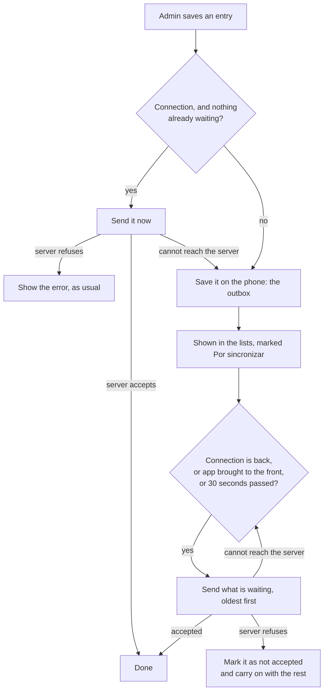

# Working offline

The app is meant to be used on a pitch or in a changing room, where the signal comes and goes. It keeps working without a connection, and anything an admin enters is saved on the phone and sent once the connection is back.

- [What works offline](#what-works-offline)
- [How it works](#how-it-works)
- [What the screen shows](#what-the-screen-shows)
- [Limits you should know about](#limits-you-should-know-about)
- [Conflicts and refusals](#conflicts-and-refusals)
- [For developers](#for-developers)

## What works offline

| | Offline |
| --- | --- |
| **Looking things up**, for everyone | Yes, showing the last data the phone saw. A screen that was never opened before has nothing to show. |
| **Registering fines**, for admins | Yes, saved on the phone and sent later. |
| **Recording payments**, income and expenses | Yes, the same way. |
| **Cancelling, restoring or deleting** a fine, and deleting a payment, income or expense | Yes. |
| Changing the roster or the fine types, settings, seasons, admins and invitations | **No**, they need a connection. |
| Closing a season | **No**, deliberately: it is destructive. |
| Signing in, first access, forgotten password | **No**, they need a connection. Someone already signed in stays signed in. |

## How it works

The pieces, in the order that matters:

1. **The outbox.** A list kept in the phone's storage, one entry per change: a new row, a delete, or a cancel. It survives closing the app. ([`lib/outbox.ts`](../src/lib/outbox.ts))
2. **Send or save.** Every everyday write goes through one function. With a connection and an empty outbox it sends straight away and a refusal is shown as before. Otherwise it saves. Changes are never sent out of order: while anything is waiting, new changes queue behind it. ([`lib/sync.ts`](../src/lib/sync.ts))
3. **Sending twice must not double the money.** Every new row gets its own id on the phone (the browser's own generator, with a fallback for iPhones before iOS 15.4, which lack it), and is sent as "insert, and do nothing if that id exists". If an answer is lost on the way and the entry is sent again, it is still one row. Deletes and cancels are harmless to repeat. This is tested against the database.
4. **Tidying the queue.** Deleting something that was never sent just removes it from the outbox; cancelling it edits it; a later cancel replaces an earlier one. Nothing pointless is sent.
5. **When it sends.** When the phone says it is back online, when the app comes to the front, every 30 seconds while something waits, at start-up, and on the **Sincronizar agora** button. ([`components/SyncManager.tsx`](../src/components/SyncManager.tsx))
6. **After sending**, every list and total is read again from the server.

Reading offline is handled separately. A service worker keeps the app itself and the last answer of every page, and the app asks for data even when offline so that saved answers are used ([`vite.config.ts`](../vite.config.ts), [`main.tsx`](../src/main.tsx)). The sign-in is kept on the phone, and so is the last answer to "is this person an admin?", so the admin screens stay available ([`lib/offlineAuth.ts`](../src/lib/offlineAuth.ts)). That cached answer only decides what is shown. The server still decides, entry by entry, what is allowed when they are sent.

## What the screen shows

- **Lists** (the fines list, a player's page, Caixa, payments, income and expenses) show waiting entries straight away, marked **Por sincronizar**. A fine, payment, income or expense waiting to be deleted shows **A apagar…** and a waiting cancel shows **A anular…** or **A repor…**.
- **Totals do not move yet.** The box, who owes what, and whether a fine is pending, overdue or paid are all worked out by the database. They change after the entries are sent, and the panel says so. This keeps the money rules in one place instead of copying them into the app.
- **A small chip in the header**, next to *Sair*, appears only when there is something to say: *Offline*, how many entries wait (*Offline · 2*, *2 por enviar*), *A sincronizar*, or *Sem resposta* when the phone thinks it is online but the server cannot be reached. It sits in the header, not over the page, so it never covers a button. Tapping it opens a panel with the full message and the list of waiting entries, where each can be discarded; tapping outside closes it. On wide screens the chip is under the menu in the sidebar.
- **Not accepted** entries stay in that list with the server's reason, in plain Portuguese for the usual ones (for example "o jogador ou o tipo de multa já não existe"), and can be tried again or discarded. A refused entry never holds up what you save after it.

### Did that really save?

Right after every save (register a fine, a payment, income or an expense, and cancel or delete) the screen says which of three things happened, so nobody believes something is saved when it is not:

| Message | What it means |
| --- | --- |
| **Guardado no servidor ✓** (green) | It reached the server. It is saved. |
| **Guardado só no telemóvel: falta enviar** (amber) | It is only on this phone, waiting for a connection. It turns green by itself once it has been sent. |
| **O servidor não aceitou: veja o Histórico** (red) | The server refused it. The reason is in Histórico. |

A short **toast** under the header says the same at the moment of saving (for example *Pagamento de 5,00 € registado*, with *Guardado no servidor ✓* or, in amber, *Só no telemóvel: falta enviar* underneath) and fades after a few seconds. The line under the form stays, so the answer is still there if the toast was missed.

Each message follows **its own** save, not the rest of the queue: an old refused entry elsewhere does not change what a new save says.

### Histórico: what is on the server and what is only here

**Menu, Histórico** has two parts. On top, **Neste telemóvel** lists this phone's entries that are waiting (**Por enviar**) or were refused (**Não aceite**, with the reason). Below, **Guardado no servidor** is the server's own record of every change, with who made it. The rule to remember:

> A change in the server's list was saved. One marked **Por enviar** is only on this phone. One marked **Não aceite** was refused.

## Limits you should know about

- **Phones do not let a web app send in the background.** Waiting entries are sent **while the app is open**. On an iPhone, open the app once you have a connection and it sends them. There is no way for the app to do it while closed.
- **The first visit needs a connection**, to download the app. After that it opens offline.
- **Signing in needs a connection.** Sign in before the match, while there is signal.
- **Entries live on that phone only.** Other devices do not see them until they are sent. Clearing the browser data, or removing the app from the Home Screen, deletes anything not yet sent. The app tells you if the phone refuses to store an entry rather than losing it quietly.
- **Two people on one phone**: each person's entries are kept apart and only sent when that person is signed in.
- **Dates are the ones chosen when the entry was made**, not the day it was sent.
- **Late fees** are added by the database when an admin opens the app with a connection, so they wait too.

## Conflicts and refusals

An entry can be refused when it is finally sent, for example the player was deleted, the person is no longer an admin, or something else changed meanwhile. The rule is simple: if the server says **no**, the entry is marked **not accepted** with its reason and everything else carries on. Nothing is dropped silently and nothing is retried by itself, because retrying cannot change a "no". The person decides: try again, or discard.

If the server **cannot be reached** (no answer, a gateway error, an expired session), that is not a refusal: sending stops and tries again later, with the rest still waiting.

## For developers

| File | Role |
| --- | --- |
| `lib/outbox.ts` | The queue: storage, folding changes together, sending in order. Pure logic over an injected storage. |
| `lib/sync.ts` | Send or save, the sending itself, the status the chip shows. |
| `lib/errors.ts` | `ApiError`, and the single rule for "try later" versus "no". |
| `lib/overlay.ts` | Puts waiting entries on top of lists, for display only. |
| `lib/saveStatus.ts`, `components/SaveStatus.tsx` | The "did that really save?" message after a save, following that save's own entries. |
| `lib/entries.ts` | Describes a waiting entry in words (used by the chip's panel and Histórico). |
| `lib/offlineAuth.ts` | The stored sign-in and the remembered admin answer. |
| `components/SyncManager.tsx` | Triggers the sending. Draws nothing. |
| `components/SyncChip.tsx` | The header chip and its panel. |

**Adding another write that works offline:** make it a draft in `lib/api.ts` (insert with a new id, delete, or cancel), add its table to `Table` in `outbox.ts` if it is new, and show it in the list through `lib/overlay.ts`. Anything needing the database to compute a result, or that must not be done blind (settings, seasons, admins), should stay online-only.

**Trying it by hand.** Run `npm run dev:test`, sign in as the main admin, then switch the browser's network to Offline in its developer tools. Register a fine or a payment, see it marked, switch back to Online, and watch the chip send it. To simulate a server that is down while the phone says online, stop the backend process instead.

**Tests.** `src/lib/outbox.test.ts` (the queue and its folding rules), `src/lib/sync.test.ts` (saving, order, retries, refusals, no session, two users, with a stand-in for the server), `src/lib/overlay.test.ts` (what lists show) and `supabase/tests/offline.test.ts` (sending the same entry twice makes one row, under the real access rules).

What is **not** covered by tests: the service worker, the screens, and a real phone losing signal. Check those by hand after changes here.
